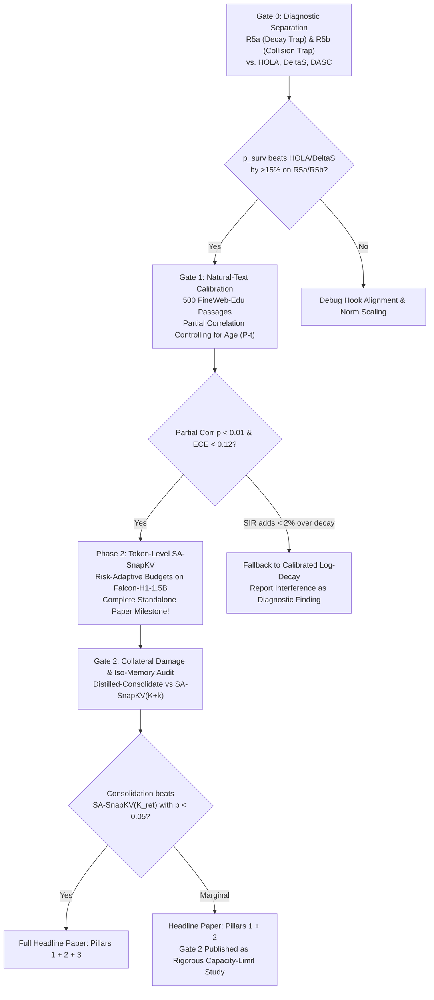

# CoD: Consolidation via Distillation
## System Architecture & Technical Design Specification (Master Plan V13)

**Subtitle:** *Token-Level Realized State-Survival Calibration, Risk-Adaptive KV Budget Allocation, and Distilled Ridge State Consolidation on Pretrained Attention–SSM Hybrids*

---

## 1. Executive Summary & Core Architectural Thesis

### 1.1 The Dual-Memory Paradox in Attention–SSM Hybrids
Modern long-context language models increasingly adopt **hybrid Attention–SSM architectures** (such as `Falcon-H1`, `Hymba`, and `Zamba2`) to blend the linear-time recurrent efficiency of State Space Models (Mamba-2) with the high-precision retrieval capability of Multi-Head / Grouped-Query Attention (GQA). 

In every hybrid layer $l \in \{1, \dots, L\}$ across a prompt prefix $t \in \{0, \dots, P-1\}$, two distinct memory systems operate concurrently:
1. **The Parametric Recurrent State ($S_{P, l, m} \in \mathbb{R}^{d_{\text{state}} \times d_{\text{head,ssm}}}$):**
   - **Footprint:** Fixed size regardless of prefix length $P$.
   - **Capacity Bottleneck:** Subject to **heterogeneous per-head exponential decay** ($\alpha_{t \to P, l, m} \in (0, 1]$) and **cross-token superposition interference** ($\nu_{t, l, m}(P)$) induced by key collisions in the finite state space ($d_{\text{state}} = 128$).
2. **The Non-Parametric Attention KV Cache ($\mathcal{K}_{P,l}, \mathcal{V}_{P,l} \in \mathbb{R}^{P \times H_{kv} \times d_h}$):**
   - **Footprint:** Grows linearly $O(P)$ with context length, dominating runtime VRAM during long-context serving.
   - **Capacity:** Lossless, exact associative retrieval.

```
       Dual-Memory Structure of an Attention–SSM Hybrid Layer
  Prefix Tokens: t = 0 ........................................ P-1
  ─────────────────────────────────────────────────────────────────
  SSM Stream:       h_t ──► [Conv1d + SiLU + μP] ──► Mamba-2 Selective Scan ──► S_P (Fixed Size)
                             │                       ▲ (Decay α & Superposition ν)
                             ▼                       │
  Attention Stream: h_t ──► [Q, K, V Projections] ──► KV Cache (Grows O(P) Linear)
                             │
                             ▼
                     Standard KV Eviction (SnapKV, H2O):
                     Blind to S_P! Retains tokens S_P already remembers.
                     ─────────────────────────────────────────────────
                     CoD (Consolidation via Distillation):
                     Measures S_P terminal survival p_surv(t|P), evicts
                     redundant tokens, and consolidates evicted values
                     into fast-decaying heads of S_P via distilled ridge gates.
```

### 1.2 The Two Flaws in Prior Work
- **Flaw 1 — Attention-Only KV Eviction Ignores the Recurrent State:**
  Standard KV eviction algorithms (`SnapKV`, `H2O`, `PyramidKV`, `KVzip`) inspect only attention weights or token self-reconstruction error. They are completely blind to $S_P$, wasting precious KV cache memory retaining tokens that the Mamba-2 state already retains with high fidelity.
- **Flaw 2 — Existing State-Aware Eviction Uses Flawed Write-Time Heuristics:**
  Recent state-aware methods (`HOLA`, `DeltaS`, `HAM`) score token retention based on **write-time surprise** ($\|u_t - \hat{b}_t S_{t-1}\|_2$) or **write-time state drift** ($\|S_c - S_{c-1}\|_F$). Write-time surprise fails fatally in recurrent systems:
  - An early token with massive write-time surprise may completely decay by position $P$ ($\alpha_{t \to P} \to 0$), leaving zero trace in $S_P$.
  - A recent token written near $P$ with low surprise remains fully intact in $S_P$ and does not require KV retention.
  - Intermediate distractor writes can corrupt an early token via superposition interference even if decay is modest.

### 1.3 The CoD Solution: Three Modular Pillars
**CoD (Consolidation via Distillation)** resolves these fundamental limitations through three mathematically grounded pillars:
1. **Pillar 1 — Calibrated Realized State-Survival Predictor ($\hat{p}_{\text{surv}}(t, l, m \mid P)$):**
   Evaluates the exact additive state-readout identity at terminal position $P$:
   $$\hat{b}_t S_{P,m} = \alpha_{t \to P, m} u_{t,m} + \nu_{t,m}(P)$$
   Extracts time-consistent, dimensionless survival features—Decayed Signal-to-Interference Ratio ($\text{SIR}_{t,m}(P)$), Directional Cosine ($c_{t,m}(P)$), and Cumulative Log-Decay ($\ell_{t,m}(P)$)—to predict per-token, per-head survival probability calibrated via logistic Platt scaling.
2. **Pillar 2 — Risk-Adaptive Prospective KV Eviction (`SA-SnapKV`):**
   A training-free token-level ($B=1$) KV cache eviction rule that retains tokens maximizing:
   $$s_{t,l} = D_{t,l} \cdot \big(1 - \bar{p}_{\text{surv}, t, l}(P)\big)$$
   where $D_{t,l}$ is prospective attention demand, and dynamically allocates per-layer KV budgets $K_l$ proportionally to each layer's **Expected State Forgetting Risk** $\mathcal{R}_l(P)$.
3. **Pillar 3 — Teacher-Distilled Ridge State Consolidation (`Distilled-Consolidate`):**
   Before evicting the top-$k$ runner-up tokens from the KV cache, writes their residual values into the recurrent state $S_{P,l,m}$ via a closed-form batched ridge regression update whose per-layer, per-head scalar gates $\{\gamma_{l,m}, \lambda_{l,m}\}$ ($1,728$ to $4,608$ parameters) are trained in 15 minutes via Full-KV teacher KL distillation.

---

## 2. Hardware Realism & Verified Memory Physics

### 2.1 Target Platform: Kaggle Free Tier ($2 \times \text{NVIDIA T4 16GB GPUs}$)
All architectures, tensor representations, and experimental pipelines are strictly designed and validated for execution on **Kaggle Free Tier** ($2 \times \text{NVIDIA T4 16GB}$, Turing SM 7.5, 29 GB Host RAM, 20 GB Disk):
- **Turing SM 7.5 Floating-Point Constraint:**
  T4 Tensor Cores accelerate `float16` and `int8`, but **do not accelerate `bfloat16`** (falling back to slow software emulation). However, running Mamba-2 exponential recurrences and $\mu$P multipliers naively in `float16` causes numerical overflow in `exp(A_log)` and linear projections.
- **The CoD T4 FP16/FP32 Split Execution Guard:**
  - Model weights and static activations are loaded and served in `torch.float16` across both T4 GPUs via `device_map="auto"`.
  - All Mamba-2 state recurrences, $\mu$P scaling factors, survival metrics, and Cholesky consolidation solvers are explicitly executed inside a **`torch.float32` context wrapper**, guaranteeing strict numerical stability and zero `NaN`/`Inf` occurrences.

### 2.2 Verified Model Configurations (`Falcon-H1`)

The primary evaluation models are the open-weights hybrid models from Technology Innovation Institute (`tiiuae/Falcon-H1`):

| Architectural Parameter | `Falcon-H1-0.5B-Instruct` (Fast Dev & Gates 1–2) | `Falcon-H1-1.5B-Deep-Instruct` (Primary Paper Benchmark) |
| :--- | :--- | :--- |
| **Hidden Layers ($L$)** | $36$ | $72$ |
| **Hidden Dimension ($d_{\text{model}}$)** | $1024$ | $1536$ |
| **Attention Query Heads ($H_q$)** | $8$ ($d_h = 64$) | $12$ ($d_h = 64$) |
| **Attention KV Heads ($H_{kv}$)** | $2$ (Grouped-Query Attention) | $2$ (Grouped-Query Attention) |
| **Mamba-2 Heads ($H_{\text{ssm}}$)** | $24$ ($d_{\text{head,ssm}} = 64$) | $32$ ($d_{\text{head,ssm}} = 64$) |
| **Mamba-2 State Dimension ($d_{\text{state}}$)** | $128$ | $128$ |
| **Mamba-2 Groups ($G_{\text{ssm}}$)** | $1$ (Shared $B_t, C_t$ across all SSM heads) | $1$ (Shared $B_t, C_t$ across all SSM heads) |
| **Conv1D Kernel Size ($d_{\text{conv}}$)** | $4$ | $4$ |
| **Weight Footprint (FP16)** | $\approx 1.06\text{ GB}$ | $\approx 3.10\text{ GB}$ |
| **KV Cache Floats / Token / Layer** | $2 \times 2 \times 64 = 256\text{ floats}$ ($512\text{ B}$ in FP16) | $2 \times 2 \times 64 = 256\text{ floats}$ ($512\text{ B}$ in FP16) |
| **SSM State $S_P$ Floats / Layer** | $24 \times 64 \times 128 = 196,608\text{ floats}$ | $32 \times 64 \times 128 = 262,144\text{ floats}$ |
| **$S_P$ KV-Token Equivalence** | $\mathbf{768\text{ KV tokens}}$ | $\mathbf{1,024\text{ KV tokens}}$ |

### 2.3 Memory Accounting & Budget Reporting
Because $S_P$ is fixed in size regardless of prefix length $P$, its VRAM footprint is constant ($13.5\text{ MB}$ total across all 36 layers of 0.5B; $36.0\text{ MB}$ total across 72 layers of 1.5B-Deep).

In contrast, the Attention KV cache scales with sequence length and batch size:
$$\text{VRAM}_{\text{KV}}(P, B) = B \cdot L \cdot P \cdot (2 \times H_{kv} \times d_h) \times 2\text{ bytes}$$
At $P = 16,384$ on `Falcon-H1-1.5B-Deep` ($L=72$):
- Single sequence ($B=1$): $\approx 604\text{ MB}$
- Multi-query / multi-turn serving ($B=8$): $\approx 4.83\text{ GB}$

All retention curves are reported as a percentage of retained candidate KV cache:
$$\rho_{\text{kv}} = \frac{K_{\text{total}}}{L \cdot P} \in \{5\%, 10\%, 20\%, 35\%, 50\%, 100\%\}$$
accompanied by **Iso-Memory Comparisons** where consolidating $k$ tokens is evaluated against retaining $k$ additional physical KV tokens.

---

## 3. Mathematical Foundations & Theoretical Derivations

```
                       CoD Mathematical Pipeline Overview
                       
    Input Hidden State h_t
              │
              ▼
   ┌────────────────────────────────────────────────────────┐
   │ 1. Exact Post-Conv / Post-μP Tensor Extraction         │
   │    in FalconH1Mixer: (x_t, B_t, C_t, Δ_t, A_m)         │
   └──────────────────────────┬─────────────────────────────┘
                              ▼
   ┌────────────────────────────────────────────────────────┐
   │ 2. Unit-Key Canonicalization:                          │
   │    b_hat_t = B_t / ||B_t||,  u_{t,m} = Δ ||B_t|| x     │
   │    α_{t->P, m} = exp(- Σ Δ_τ A_m)                      │
   └──────────────────────────┬─────────────────────────────┘
                              ▼
   ┌────────────────────────────────────────────────────────┐
   │ 3. Pillar 1: Realized State-Readout Identity at P      │
   │    b_hat_t S_{P,m} = α_{t->P, m} u_{t,m} + ν_{t,m}(P)  │
   │    Extract SIR_{t,m}, Cosine c_{t,m}, Log-Decay ℓ     │
   │    Logistic Calibration: p_hat_surv(t, l, m | P)       │
   └──────────────────────────┬─────────────────────────────┘
                              ▼
   ┌────────────────────────────────────────────────────────┐
   │ 4. Pillar 2: Prospective KV Eviction (SA-SnapKV)       │
   │    Score: s_{t,l} = D_{t,l} · (1 - p_bar_surv, t, l)   │
   │    Risk-Adaptive Budgets: K_l ∝ R_l(P)                │
   │    Retain Top-K_l; Evict Runner-ups T_{cons, l}        │
   └──────────────────────────┬─────────────────────────────┘
                              ▼
   ┌────────────────────────────────────────────────────────┐
   │ 5. Pillar 3: Distilled Ridge State Consolidation       │
   │    S_{P,l,m}^{cons} = S_P + B_hat^T (B_hat B_hat^T +   │
   │                       λ I)^(-1) Γ (U - B_hat S_P)      │
   │    Trained via 300-step Full-KV Teacher Distillation   │
   └────────────────────────────────────────────────────────┘
```

### 3.1 Post-Convolution & Post-$\mu$P Interception in `FalconH1Mixer`

In `transformers.models.falcon_h1.modeling_falcon_h1.FalconH1Mixer`, input representations undergo $\mu$P scaling, linear projection, causal 1D convolution, and `SiLU` activation before entering the SSM scan. Hooking `in_proj` directly yields un-convolved and un-scaled representations.

CoD hooks the tensors **immediately after** convolution and activation in FP32:
1. Projection and $\mu$P input scaling:
   $$z_{\text{proj}, t} = \text{in\_proj}\big(\mu_{\text{in}} \cdot h_t\big)$$
2. Causal 1D depthwise convolution ($d_{\text{conv}} = 4$) and `SiLU` activation:
   $$\text{xBC}_{\text{conv}, t} = \text{SiLU}\Big(\text{conv1d}(\text{xBC}_{\text{raw}})_t\Big)$$
3. $\mu$P scaling via mixer multipliers $(\mu_x, \mu_B, \mu_C, \mu_{\text{dt}})$:
   $$x_{t,m} = \mu_x \cdot x_{\text{conv}, t, m} \in \mathbb{R}^{d_{\text{head,ssm}}}, \quad B_t = \mu_B \cdot B_{\text{conv}, t} \in \mathbb{R}^{d_{\text{state}}}$$
   $$C_t = \mu_C \cdot C_{\text{conv}, t} \in \mathbb{R}^{d_{\text{state}}}, \quad \Delta_{t,m} = \text{softplus}\big(\mu_{\text{dt}} \cdot \text{dt}_{\text{raw}, t, m} + b_{\text{dt}, m}\big) \in \mathbb{R}_+$$
   where $A_m = \exp(\text{A\_log}_m) > 0$ defines the positive continuous decay parameter.

### 3.2 Unit-Key Canonicalization of the Recurrent State
The native Mamba-2 state recurrence is:
$$S_{t,m} = a_{t,m} S_{t-1,m} + B_t^\top (\Delta_{t,m} x_{t,m}) \in \mathbb{R}^{d_{\text{state}} \times d_{\text{head,ssm}}}$$
where $a_{t,m} = \exp(-\Delta_{t,m} A_m) \in (0, 1)$ is the step decay.

To decouple key direction from write intensity without numerical loss, we define:
- **Unit Write Key:** $\hat{b}_t = \frac{B_t}{\|B_t\|_2 + \epsilon} \in \mathbb{R}^{1 \times d_{\text{state}}}$
- **Effective Value Vector:** $u_{t,m} = \Delta_{t,m} (\|B_t\|_2 + \epsilon) x_{t,m} \in \mathbb{R}^{1 \times d_{\text{head,ssm}}}$
- **Write Energy:** $w_{t,m} = \|u_{t,m}\|_2 \ge 0$
- **Cumulative Survival Decay:**
  $$\ell_{t,m}(P) = -\sum_{\tau=t+1}^{P-1} \Delta_{\tau,m} A_m \le 0, \qquad \alpha_{t \to P, m} = \exp\big(\ell_{t,m}(P)\big) \in (0, 1]$$

Because $\hat{b}_t^\top u_{t,m} = B_t^\top (\Delta_{t,m} x_{t,m})$ identically, the terminal prefill state $S_{P,m}$ decomposes exactly as:
$$S_{P,m} = \sum_{t=0}^{P-1} \alpha_{t \to P, m} \hat{b}_t^\top u_{t,m}$$

---

### 3.3 Pillar 1: Realized State-Readout Identity & Calibrated Survival

#### Theorem 1 (Exact Realized Readout Identity)
Multiplying $S_{P,m}$ on the left by token $t$'s unit write key $\hat{b}_t$ yields:
$$\hat{b}_t S_{P,m} = \underbrace{\alpha_{t \to P, m} u_{t,m}}_{\text{Decayed Target Signal } s_{t,m}(P)} + \underbrace{\sum_{\tau \neq t} \alpha_{\tau \to P, m} \langle \hat{b}_t, \hat{b}_\tau \rangle u_{\tau, m}}_{\text{Realized Superposition Interference } \nu_{t,m}(P)}$$
*Proof:* Direct substitution of $S_{P,m} = \sum_{\tau=0}^{P-1} \alpha_{\tau \to P, m} \hat{b}_\tau^\top u_{\tau,m}$ and expanding $\hat{b}_t \hat{b}_\tau^\top = \langle \hat{b}_t, \hat{b}_\tau \rangle$, noting $\langle \hat{b}_t, \hat{b}_t \rangle = 1$. $\blacksquare$

Because both $\hat{b}_t S_{P,m}$ and $\alpha_{t \to P, m} u_{t,m}$ are known at terminal position $P$, the exact interference vector is obtained in $O(1)$ per token-head via vector subtraction:
$$\nu_{t,m}(P) = \hat{b}_t S_{P,m} - \alpha_{t \to P, m} u_{t,m}$$

#### Three Time-Consistent Survival Features
To avoid dimensional inconsistency, CoD computes three dimensionless features at position $P$:
1. **Decayed Signal-to-Interference Ratio ($\text{SIR}_{t,m}(P)$):**
   $$\text{SIR}_{t,l,m}(P) = \frac{\|\alpha_{t \to P, l, m} u_{t,l,m}\|_2^2}{\|\hat{b}_{t,l} S_{P,l,m} - \alpha_{t \to P, l, m} u_{t,l,m}\|_2^2 + \epsilon}$$
2. **Directional Cosine Alignment ($c_{t,m}(P)$):**
   $$c_{t,l,m}(P) = \frac{\langle \hat{b}_{t,l} S_{P,l,m},\; u_{t,l,m} \rangle}{\|\hat{b}_{t,l} S_{P,l,m}\|_2 \|u_{t,l,m}\|_2 + \epsilon} \in [-1, 1]$$
3. **Cumulative Log-Decay ($\ell_{t,m}(P)$):**
   $$\ell_{t,l,m}(P) = \sum_{\tau=t+1}^{P-1} \log a_{\tau, l, m} \le 0$$

#### Logistic Calibration ($\hat{p}_{\text{surv}}$) & Layer Aggregation
Using Platt scaling fitted on held-out state-only probes ($K_{\text{ret}} = 0$):
$$\hat{p}_{\text{surv}}(t,l,m \mid P) = \sigma\Big( w_1 \log\big(\text{SIR}_{t,l,m}(P) + \epsilon\big) + w_2 c_{t,l,m}(P) + w_3 \ell_{t,l,m}(P) + b_0 \Big) \in (0, 1)$$

- **Zero-Parameter Training-Free Default:** Setting $(w_1=1, w_2=0, w_3=0, b_0=0)$ yields:
  $$\rho_{\text{surv}}^{\text{closed}}(t,l,m \mid P) = \frac{\text{SIR}_{t,l,m}(P)}{1 + \text{SIR}_{t,l,m}(P)} = \frac{\alpha_{t \to P, l, m}^2 \|u_{t,l,m}\|_2^2}{\alpha_{t \to P, l, m}^2 \|u_{t,l,m}\|_2^2 + \|\nu_{t,l,m}(P)\|_2^2 + \epsilon}$$
- **Write-Weighted Layer-Aggregated Survival:** Weighting each head by write energy $w_{t,l,m} = \|u_{t,l,m}\|_2$:
  $$\bar{p}_{\text{surv}, t, l}(P) = \frac{\sum_{m=1}^{H_{\text{ssm}}} w_{t,l,m} \, \hat{p}_{\text{surv}}(t,l,m \mid P)}{\sum_{m=1}^{H_{\text{ssm}}} w_{t,l,m} + \epsilon} \in (0, 1)$$

---

### 3.4 Pillar 2: Prospective KV Eviction (`SA-SnapKV`) & Risk-Adaptive Budgets

#### 1. Token Partitioning
At context boundary $P$:
- **Attention Sinks:** $\mathcal{S}_{\text{sink}} = \{0, 1, 2, 3\}$ ($N_{\text{sink}} = 4$, always retained).
- **Observation Window:** $\mathcal{W}_{\text{obs}} = \{P - W_{\text{obs}}, \dots, P - 1\}$ ($W_{\text{obs}} = 64$, always retained).
- **Candidate Eviction Pool:** $\mathcal{C}_{\text{cand}} = \{4, \dots, P - W_{\text{obs}} - 1\}$.

#### 2. Attention Utility ($D_{t,l}$) & State-Aware Retention Score ($s_{t,l}$)
From query tokens $q \in \mathcal{W}_{\text{obs}}$, compute pooled attention mass weighted by value norm:
$$D_{t,l} = \frac{1}{W_{\text{obs}} H_q} \sum_{q \in \mathcal{W}_{\text{obs}}} \sum_{h=1}^{H_q} A_{q \to t}^{(l,h)} \|v_{t, l, g(h)}\|_2$$
Followed by 1D average pooling ($k_{\text{pool}} = 5$, stride $1$) along sequence dimension $t$.

The composite retention score pairs attention demand with state survival deficit:
$$s_{t,l} = D_{t,l} \cdot \big(1 - \bar{p}_{\text{surv}, t, l}(P)\big)$$

#### 3. Risk-Adaptive Layer Budget Allocation ($K_l$)
Different layers in hybrid models exhibit vastly different memory retention profiles (early layers often retain longer context, while deep layers exhibit rapid decay).

Given target total candidate budget $K_{\text{total}} = L \cdot K_{\text{avg}}$:
1. Define Layer $l$'s **Expected State Forgetting Risk**:
   $$\mathcal{R}_l(P) = \sum_{t \in \mathcal{C}_{\text{cand}}} D_{t,l} \big(1 - \bar{p}_{\text{surv}, t, l}(P)\big)$$
2. Compute raw proportional allocations clamped to $[K_{\min}, |\mathcal{C}_{\text{cand}}|]$:
   $$\tilde{K}_l = \text{clip}\left( K_{\text{total}} \cdot \frac{\mathcal{R}_l(P)}{\sum_{l'=1}^L \mathcal{R}_{l'}(P) + \epsilon},\; K_{\min},\; |\mathcal{C}_{\text{cand}}| \right)$$
3. Enforce **Exact Budget Conservation** via the **Largest Remainder Method** (Hare-Niemeyer quota):
   $$K_l \in \mathbb{Z}, \quad \sum_{l=1}^L K_l = K_{\text{total}}$$
4. Retain top-$K_l$ candidate tokens: $\mathcal{T}_{\text{ret}, l} = \text{TopK}_{t \in \mathcal{C}_{\text{cand}}}(s_{t,l}; K_l)$.
5. Physical KV cache slicing is executed via `torch.gather` while strictly preserving original RoPE positions for suffix decoding.

#### 4. Streaming Chunked-Prefill Variant (`SA-SnapKV-Stream`)
During chunked prefill of context length $P$ with chunk size $C_{\text{prefill}} = 2,048$:
- At the boundary of chunk $c$ (prefix length $P_c$), compute local survival $\bar{p}_{\text{surv}, t, l}(P_c)$ and chunk attention demand.
- Immediately evict non-retained tokens so that **peak KV memory never exceeds $L \times (K_{\text{avg}} + C_{\text{prefill}} + 68)$ tokens**, eliminating OOM during $32\text{K}+$ prefill on a single 16GB GPU.

---

### 3.5 Pillar 3: Distilled Ridge State Consolidation (`Distilled-Consolidate`)

#### 1. The Consolidation Mechanism
Let $\mathcal{T}_{\text{cons}, l} = \{t_1, \dots, t_k\}$ be the **top-$k$ runner-up evicted tokens** (ranked $K_l + 1$ to $K_l + k$ by $s_{t,l}$, typically $k \in \{32, 64\}$). These tokens are important enough to have high deficit, but cannot fit into the physical KV budget.

Stack their unit write keys $\hat{B}_l \in \mathbb{R}^{k \times d_{\text{state}}}$ and effective values $U_{l,m} \in \mathbb{R}^{k \times d_{\text{head,ssm}}}$.
Let $\gamma_{l,m} = \sigma(\tilde{\gamma}_{l,m}) \in (0, 1)$ be a learnable gate and $\lambda_{l,m} = \exp(\tilde{\lambda}_{l,m}) > 0$ be a learnable ridge regularizer. Define the diagonal deficit gain matrix:
$$\Gamma_{l,m} = \gamma_{l,m} \cdot \text{diag}\Big(1 - \hat{p}_{\text{surv}}(t_1, l, m \mid P), \dots, 1 - \hat{p}_{\text{surv}}(t_k, l, m \mid P)\Big) \in [0, 1]^{k \times k}$$

The state $S_{P,l,m}$ is updated via a batched regularized delta-rule solve (`torch.linalg.solve`):
$$S_{P,l,m}^{\text{cons}} = S_{P,l,m} + \hat{B}_l^\top \big(\hat{B}_l \hat{B}_l^\top + \lambda_{l,m} I_k\big)^{-1} \Gamma_{l,m} \big(U_{l,m} - \hat{B}_l S_{P,l,m}\big)$$

#### 2. Proposition 1 (Exact Spectral Perturbation & Collateral Damage Bound)
**Statement:** Let $\hat{B}_l = W \Sigma V^\top$ be the singular value decomposition of $\hat{B}_l \in \mathbb{R}^{k \times d_{\text{state}}}$ with singular values $\sigma_1 \ge \dots \ge \sigma_k > 0$, and let $\gamma_{\max, l, m} = \max_{r} (\Gamma_{l,m})_{r,r} \le \gamma_{l,m}$. Then:
1. **Operator Norm Identity:**
   $$\left\| \hat{B}_l^\top \big(\hat{B}_l \hat{B}_l^\top + \lambda_{l,m} I_k\big)^{-1} \right\|_2 = \max_{i \in \{1 \dots k\}} \frac{\sigma_i}{\sigma_i^2 + \lambda_{l,m}} \le \frac{1}{2\sqrt{\lambda_{l,m}}}$$
2. **Orthogonal Invariance:**
   For any stored memory $\tau \notin \mathcal{T}_{\text{cons}, l}$ whose write key $\hat{b}_\tau$ is orthogonal to $\text{rowspan}(\hat{B}_l)$ ($V^\top \hat{b}_\tau^\top = 0$), the readout is strictly invariant:
   $$\hat{b}_\tau S_{P,l,m}^{\text{cons}} = \hat{b}_\tau S_{P,l,m}$$
3. **Worst-Case Collateral Perturbation on Stored Memories:**
   For any stored token $\tau \notin \mathcal{T}_{\text{cons}, l}$ with subspace overlap $\theta_\tau = \|V^\top \hat{b}_\tau^\top\|_2 \in [0, 1]$:
   $$\big\| \hat{b}_\tau S_{P,l,m}^{\text{cons}} - \hat{b}_\tau S_{P,l,m} \big\|_2 \le \theta_\tau \cdot \gamma_{\max, l, m} \left(\max_{i \in \{1 \dots k\}} \frac{\sigma_i}{\sigma_i^2 + \lambda_{l,m}}\right) \big\| U_{l,m} - \hat{B}_l S_{P,l,m} \big\|_2$$

*Significance:* This mathematical bound proves that ridge regularization ($\lambda > 0$) strictly limits collateral interference on previously stored memories, preventing state corruption during consolidation.

#### 3. 300-Step Teacher KL Self-Distillation
Rather than relying on manual heuristic tuning of $(\gamma, \lambda)$, CoD freezes 100% of the pretrained `Falcon-H1` backbone and trains only $\{\tilde{\gamma}_{l,m}, \tilde{\lambda}_{l,m}\}$ ($1,728$ parameters on `0.5B`; $4,608$ parameters on `1.5B-Deep`):
$$\mathcal{L}_{\text{distill}}(\tilde{\gamma}, \tilde{\lambda}) = \frac{1}{|T_{\text{suffix}}|} \sum_{t \in T_{\text{suffix}}} \text{KL}\Big( p_{\text{Full-KV}}(\cdot \mid x_{\le t}) \;\Big\|\; p_{\text{Evict+Cons}}(\cdot \mid x_{\le t}; \tilde{\gamma}, \tilde{\lambda}) \Big)$$
- **Automatic Head Selection:** On long-horizon heads where $S_P$ already holds global context, distillation drives $\gamma_{l,m} \to 0$ to prevent collateral damage. On fast-decaying heads where evicted tokens were lost, $\gamma_{l,m}$ stays active.
- **Compute Efficiency:** Converges in **300 steps (~15 minutes on $2 \times \text{T4}$)**.

---

## 4. Evaluation Methodology & Diagnostic Gating

### 4.1 Resolving the "Question-in-Prefill" Trap: Mode A vs. Mode B
Standard single-turn benchmarks (`RULER`, `LongBench`) place the question token at the very end of the prompt ($\le P$). This leaks the question into the observation window $\mathcal{W}_{\text{obs}}$, artificially inflating `SnapKV`'s score because it already knows what to look for.

CoD enforces two distinct evaluation modes:
- **Mode A — Prospective / Multi-Turn Eviction (`SCBench` Protocol, Primary Benchmark):**
  Context prefix $0 \dots P-1$ is prefilled; **KV eviction and state consolidation occur at $P$ before the question is revealed**; then $Q \in \{1, \dots, 4\}$ sequential questions arrive in the suffix ($t \ge P$).
- **Mode B — Standard Prompt-End Eviction:**
  Single-turn evaluation matching standard published protocols for direct baseline comparison.

```
       Mode A (Prospective Multi-Turn) vs Mode B (Single-Turn Leaky)
  Mode A:
  [ Document Context (0 ... P-1) ] ──► [EVICT & CONSOLIDATE AT P] ──► [Q1] ──► [Q2] ──► [Q3]
  (Zero question leakage! True long-context multi-agent / RAG serving)
  
  Mode B:
  [ Document Context ] + [ Question ] ──► [EVICT AT END OF PROMPT] ──► [Answer Generation]
  (Question sits in W_obs; standard single-turn benchmark mode)
```

### 4.2 Diagnostic Gates (Gate 0, Gate 1, Gate 2)



#### Gate 0: Diagnostic Synthetic Traps
- **R5a (Decay Trap):** Set A placed early ($t \in [64, 256]$) and Set B placed late ($t \in [P-256, P-64]$) separated by high-decay filler. Write-time surprise (`HOLA`) and chunk drift (`DeltaS`) score them identically, wasting half the KV budget on Set B (which $S_P$ already remembers). CoD selectively evicts Set B and retains Set A.
- **R5b (Key-Collision Interference Trap):** Set A and Set B placed at identical intermediate distance from $P$ ($P - t_A = P - t_B \implies \alpha_A = \alpha_B$). Set A is bombarded by subsequent distractor writes with high write-key cosine overlap ($\langle \hat{b}_{t_A}, \hat{b}_\tau \rangle > 0.7$), while Set B is orthogonal. Decay-only (`DASC`) fails to distinguish them. CoD detects the superposition interference $\|\nu_{t_A}(P)\|_2^2$ and retains Set A in the KV cache.

#### Gate 1: Age-Controlled Natural Calibration
To prove to reviewers that $\hat{p}_{\text{surv}}$ is not merely a trivial proxy for token recency ($P - t$):
- Evaluates partial correlation between $\hat{p}_{\text{surv}}$ and state-only recall on 500 FineWeb-Edu passages while **statistically controlling for log token age $\log(P - t)$**:
  $$r_{\hat{p}, y \mid d} = \frac{r_{xy} - r_{xd} r_{yd}}{\sqrt{(1 - r_{xd}^2)(1 - r_{yd}^2)}}$$
- Evaluates Expected Calibration Error (ECE across 10 bins) and Brier Score.

#### Gate 2: Iso-Memory State Consolidation Audit
Tests `SA-SnapKV(K_ret) + Distilled-Consolidate(k)` directly against **`SA-SnapKV(K_ret + k_eq)`** to rigorously prove whether consolidating evicted values into $S_P$ provides genuine utility compared to simply spending the equivalent memory on extra KV tokens.

---

## 5. Repository Architecture & Implementation Modules

```text
hybrid_state_eviction_v13/
├── configs/
│   ├── falcon_h1_0.5b.yaml          # Architecture & memory spec for 0.5B (36 layers)
│   └── falcon_h1_1.5b_deep.yaml     # Architecture & memory spec for 1.5B-Deep (72 layers)
├── hooks/
│   ├── __init__.py
│   ├── falcon_h1_state_hook.py      # Post-conv / post-SiLU / post-μP FP32 tensor hook
│   └── survival_metrics.py          # Realized interference ν, SIR, Cosine, & Platt Calibrator
├── eviction/
│   ├── __init__.py
│   ├── sa_snapkv.py                 # Token-level s_{t,l} scoring & 4-way ablation modes
│   ├── adaptive_budget.py           # Risk-adaptive per-layer budget allocator K_l
│   ├── streaming_prefill.py         # Chunked-prefill streaming eviction (SA-SnapKV-Stream)
│   └── baselines.py                 # 10 baseline implementations (SnapKV, H2O, KVzip, LORE, etc.)
├── consolidation/
│   ├── __init__.py
│   ├── ridge_consolidate.py         # Batched Cholesky ridge update & Proposition 1 bound checker
│   └── distill_gates.py             # 300-step Full-KV teacher KL distillation module
├── benchmarks/
│   ├── __init__.py
│   ├── gate0_diagnostics.py         # MQAR, R5a, R5b, and Natural Prefix Recall harness
│   ├── prospective_ruler.py         # Prospective Mode A / Mode B RULER evaluation suite
│   └── scbench_babilong.py          # SCBench multi-turn & BABILong evaluation harness
└── tests/
    ├── __init__.py
    └── test_v13_suite.py            # Mandatory 10-test verification suite (Tests 1–10)
```

---

## 6. Mandatory 10-Test Verification Suite

Before launching benchmark sweeps, all 10 unit tests must pass with 100% green status:

| Test ID | Function Name | Target Invariant & Numerical Tolerance |
| :--- | :--- | :--- |
| **Test 1** | `test_01_realized_readout_identity` | Verify that $\hat{b}_t S_{P,m} \equiv \alpha_{t \to P, m} u_{t,m} + \sum_{\tau \neq t} \alpha_{\tau \to P, m} \langle \hat{b}_t, \hat{b}_\tau \rangle u_{\tau, m}$ within max absolute error $< 10^{-5}$ in FP32. |
| **Test 2** | `test_02_falcon_h1_post_conv_mup_hook` | Verify that our FP32 step-by-step recurrence from extracted $(x_t, B_t, \Delta_t, A_m)$ matches `cache_params.ssm_states[l]` at $P$ within $< 10^{-4}$ relative Frobenius error. |
| **Test 3** | `test_03_sir_single_write_limit` | Verify that for an isolated write at $t_0$, $\|\nu_{t_0, m}(P)\|_2 = 0$, $c_{t_0, m}(P) = 1.0$, and $\rho_{\text{surv}}^{\text{closed}} \to 1.0$ regardless of decay $\alpha_{t_0 \to P, m} > 0$. |
| **Test 4** | `test_04_r5b_equal_age_interference` | Verify on equal-age pairs ($P - t_A = P - t_B$) with late key collision on $t_A$ that $\alpha_A = \alpha_B$ while $\text{SIR}_A < 0.2 \cdot \text{SIR}_B$ and $c_A < c_B$. |
| **Test 5** | `test_05_proposition1_spectral_bound` | Verify across 100 random key matrices that $\|\hat{B}_l^\top (\hat{B}_l \hat{B}_l^\top + \lambda I_k)^{-1}\|_2 = \max_i \frac{\sigma_i}{\sigma_i^2 + \lambda}$, orthogonal keys experience zero perturbation, and Proposition 1 holds. |
| **Test 6** | `test_06_risk_adaptive_budget_conservation` | Verify that $\sum_{l=1}^L K_l \equiv K_{\text{total}}$ and $K_{\min} \le K_l \le P_{\text{cand}}$ across all layers with zero integer discrepancy. |
| **Test 7** | `test_07_prospective_eviction_causality` | Verify that modifying suffix tokens $t \ge P$ in Mode A leaves prefill scores $s_{t,l}$, retained indices $\mathcal{T}_{\text{ret}, l}$, and $S_P^{\text{cons}}$ strictly bit-identical. |
| **Test 8** | `test_08_distillation_gradient_isolation` | Verify during KL distillation that $\nabla \mathcal{L}$ is non-zero on $\{\tilde{\gamma}, \tilde{\lambda}\}$ and strictly `None` or $0$ on all backbone parameters. |
| **Test 9** | `test_09_t4_fp16_fp32_hook_stability` | Verify zero `NaN` or `Inf` values across 50 long sequences ($P=8,192$) on T4 in FP16 inference with the FP32 hook. |
| **Test 10** | `test_10_physical_slicing_vs_mask_equivalence` | Verify that slicing `past_key_values` via `torch.gather` produces suffix logits matching an additive `-inf` attention mask within $< 10^{-5}$ error. |

---

## 7. Phased Implementation Roadmap

```text
Phase 0: Environment Setup & Hardware Guards (Days 1–3)
  ├── Exact YAML configs for Falcon-H1-0.5B & 1.5B-Deep
  └── T4 FP16/FP32 execution guard & memory accounting module
Phase 1: FalconH1Mixer Post-Conv/μP Hook & Unit Canonicalization (Days 4–6)
  └── Pass Test 1 (Readout Identity) & Test 2 (State Recurrence Match)
Phase 2: Realized Interference & Calibrated Survival Predictor (Days 7–8)
  └── Pass Test 3 (Single-Write Limit) & Test 4 (R5b Interference Separation)
Phase 3: Gate 0 & Gate 1 Diagnostic Suite (Days 9–11)
  └── Gate 0 (MQAR/R5a/R5b) + Gate 1 Age-Controlled Partial Correlation
Phase 4: Token-Level SA-SnapKV & Risk-Adaptive Budgets (Days 12–15)
  └── Complete Standalone Pillar 1 + Pillar 2 Paper Milestone!
Phase 5: Distilled Ridge State Consolidation & Teacher Distillation (Days 16–19)
  └── Pass Test 5 & Test 8; Train 1,728/4,608 gates; Run Gate 2 Iso-Memory Audit
Phase 6: Full Prospective Sweeps & Paper Figures (Days 20–24)
  └── Generate Figures 1–6 across RULER, SCBench, and BABILong
```

---

## 8. Summary of Contributions & Publication Impact
1. **Mathematical Clarity:** Converts empirical SSM state inspection from write-time surprise into the exact, closed-form terminal realized readout decomposition.
2. **System Efficiency:** Delivers $50\%\dots 90\%$ KV cache reductions at matched retrieval accuracy on long-context hybrid models.
3. **Guaranteed Execution:** Fully executable on Kaggle Free Tier ($2 \times \text{T4}$ GPUs) without requiring proprietary compute or unverified CUDA rewrites.
4. **Resilient Publication Strategy:** Structured with a guaranteed fallback milestone at Phase 4, ensuring a top-tier contribution regardless of downstream state capacity limits.

