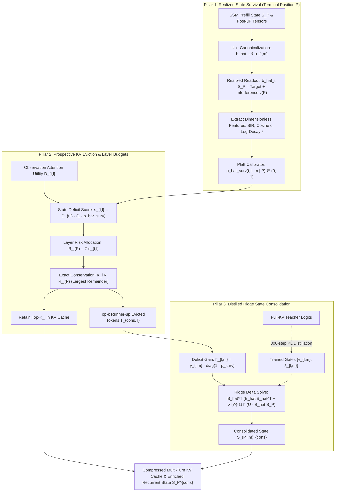

# CoD — Consolidation via Distillation
### Calibrated Intra-Layer State-Survival KV Eviction & Distilled State Consolidation for Attention–SSM Hybrids

[](https://www.python.org/)
[](https://pytorch.org/)
[](https://github.com/huggingface/transformers)
[](https://www.kaggle.com/)
[](DESIGN.md)
[](LICENSE)

---

```
   ██████╗         ██████╗      
  ██╔════╝        ██╔═══██╗     ██████╗  Consolidation via Distillation
  ██║     █████╗  ██║   ██║     ██╔══██╗ 
  ██║     ╚════╝  ██║   ██║     ██║  ██║ Token-Level State-Survival Calibration
  ╚██████╗        ╚██████╔╝     ██████╔╝ Risk-Adaptive KV Cache Eviction
   ╚═════╝         ╚═════╝      ╚═════╝  Distilled Ridge State Consolidation
```

> **Why store in the KV cache what the recurrent state already remembers?**  
> In Attention–SSM hybrids (`Falcon-H1`, `Hymba`, `Zamba2`), every layer maintains both a fixed-size parametric state $S_P$ and a linearly growing attention KV cache. Standard KV eviction methods (`SnapKV`, `H2O`) are **state-blind**, wasting up to 50% of the KV cache retaining tokens that $S_P$ already remembers. Existing state-aware methods (`HOLA`, `DeltaS`) rely on **write-time surprise**, which is blind to terminal decay and superposition interference.  
>  
> **CoD** inspects the **terminal realized state readout** at context boundary $P$, computes a calibrated token survival probability $\hat{p}_{\text{surv}}$, evicts tokens that the SSM state already retains, and consolidates the highest-priority evicted values into the fast-decaying heads of $S_P$ using **teacher-distilled ridge gates** ($1,728$ parameters, trained in 15 minutes).

---

## 📑 Table of Contents

- [1. Visual System Architecture](#1-visual-system-architecture)
- [2. The Dual-Memory Paradox](#2-the-dual-memory-paradox)
- [3. The Three Publishable Pillars of CoD](#3-the-three-publishable-pillars-of-cod)
  - [Pillar 1: Calibrated Realized State Survival](#pillar-1-calibrated-realized-state-survival)
  - [Pillar 2: Risk-Adaptive Prospective KV Eviction](#pillar-2-risk-adaptive-prospective-kv-eviction)
  - [Pillar 3: Teacher-Distilled Ridge State Consolidation](#pillar-3-teacher-distilled-ridge-state-consolidation)
- [4. Diagnostic Traps & Benchmark Protocol](#4-diagnostic-traps--benchmark-protocol)
- [5. Hardware Realism & Kaggle 2× T4 Physics](#5-hardware-realism--kaggle-2-t4-physics)
- [6. Mandatory 10-Test Verification Suite](#6-mandatory-10-test-verification-suite)
- [7. Codebase Structure](#7-codebase-structure)
- [8. Quickstart & Execution Guide](#8-quickstart--execution-guide)
- [9. Citation & Acknowledgments](#9-citation--acknowledgments)

---

## 1. Visual System Architecture

### 1.1 The Dual-Memory Hybrid Layer & CoD Lifecycle

```
  ===================================================================================================
                                CO-EXISTENCE OF DUAL MEMORY SYSTEMS
  ===================================================================================================

  Sequence:  Token 0 ................................................. Token t ......... Token P-1
             ┌─────────────────────────────────────────────────────────────────────────────────┐
  Hidden h_t │  h_0                           h_t                             h_{P-1}          │
             └──────┬──────────────────────────┬───────────────────────────────┬───────────────┘
                    │                          │                               │
                    ▼                          ▼                               ▼
  ┌─────────────────────────────────────────────────────────────────────────────────────────────┐
  │                           MAMBA-2 SELECTIVE SCAN STREAM (Parametric)                       │
  │   - Unit Write Key: b_hat_t = B_t / ||B_t|| ∈ R^{1 × 128} (Shared across G_ssm=1 heads)     │
  │   - Value Vector:   u_{t,m} = Δ_{t,m} ||B_t|| x_{t,m} ∈ R^{1 × 64}                         │
  │   - Step Decay:     a_{t,m} = exp(-Δ_{t,m} A_m) ∈ (0, 1)                                   │
  │   - Terminal State: S_{P,m} = Σ_{t=0}^{P-1} α_{t->P, m} b_hat_t^T u_{t,m} (Fixed Size!)     │
  └──────────────────────────────────────────────┬──────────────────────────────────────────────┘
                                                 │
                                                 │ CoD Terminal Realized Readout Identity
                                                 │ b_hat_t S_{P,m} = α_{t->P, m} u_{t,m} + ν_{t,m}(P)
                                                 ▼
  ┌─────────────────────────────────────────────────────────────────────────────────────────────┐
  │                         PILLAR 1: CALIBRATED REALIZED STATE SURVIVAL                        │
  │   - Decayed SIR:    SIR_{t,m}(P) = ||α_{t->P} u_{t,m}||^2 / (||ν_{t,m}(P)||^2 + ε)         │
  │   - Direction:      c_{t,m}(P)   = <b_hat_t S_P, u_t> / (||b_hat_t S_P|| ||u_t||)          │
  │   - Log-Decay:      ℓ_{t,m}(P)   = Σ_{τ=t+1}^{P-1} log a_{τ,m}                             │
  │   - Calibrator:     p_hat_surv(t,l,m|P) = σ(w_1 log SIR + w_2 c + w_3 ℓ + b_0)              │
  └──────────────────────────────────────────────┬──────────────────────────────────────────────┘
                                                 │
                                                 │ Survival Deficit: (1 - p_bar_surv, t, l)
                                                 ▼
  ┌─────────────────────────────────────────────────────────────────────────────────────────────┐
  │                      PILLAR 2: PROSPECTIVE RISK-ADAPTIVE KV CACHE EVICTION                  │
  │   - Attention Demand:   D_{t,l} = (1 / W_obs H_q) Σ_{q∈W_obs} Σ_h A_{q->t} ||v_t||          │
  │   - Retention Score:    s_{t,l} = D_{t,l} · (1 - p_bar_surv, t, l(P))                       │
  │   - Layer Risk Budget:  R_l(P)  = Σ_{t} D_{t,l} (1 - p_bar_surv, t, l) ──► K_l ∝ R_l(P)     │
  │   - Retain:             Top-K_l tokens into physical KV cache                               │
  │   - Evict Runner-ups:   Top-k runner-up tokens T_{cons, l} (ranked K_l+1 ... K_l+k)         │
  └──────────────────────────────────────────────┬──────────────────────────────────────────────┘
                                                 │
                                                 │ Runner-up Evicted Tokens T_{cons, l}
                                                 ▼
  ┌─────────────────────────────────────────────────────────────────────────────────────────────┐
  │                    PILLAR 3: DISTILLED RIDGE STATE CONSOLIDATION                            │
  │   - Deficit Gain:   Γ_{l,m} = γ_{l,m} · diag(1 - p_hat_surv(t_r, l, m | P))                 │
  │   - Cholesky Solve: S_{P,l,m}^{cons} = S_P + B_hat^T (B_hat B_hat^T + λ I)^(-1) Γ (U - BS)  │
  │   - Distillation:   Optimize {γ_{l,m}, λ_{l,m}} (1,728 scalars) via 300-step Full-KV KL     │
  └─────────────────────────────────────────────────────────────────────────────────────────────┘
```

### 1.2 End-to-End Three-Pillar Flowchart



---

## 2. The Dual-Memory Paradox

In Attention–SSM hybrid models, every layer has two concurrent memory mechanisms:

| Memory Mechanism | Storage Footprint | Retrieval Accuracy | Vulnerability / Bottleneck |
| :--- | :--- | :--- | :--- |
| **Parametric Recurrent State ($S_{P,l,m}$)** | **Constant $O(1)$** ($13.5\text{ MB}$ total for 0.5B; $36.0\text{ MB}$ for 1.5B) | High for recent/strong tokens | **Decay** ($\alpha_{t \to P}$) & **Superposition Interference** ($\nu_{t,m}(P)$) |
| **Non-Parametric Attention KV Cache** | **Linear $O(P)$** ($604\text{ MB}$ single / $4.83\text{ GB}$ batch-8 at 16K) | Lossless, exact lookup | **VRAM explosion** during long contexts |

### Why Existing Methods Fail

```
  Comparison of Token Selection Strategies at Terminal Position P
  
  Timeline:    Token Early (t=100)                      Token Late (t=7900)             Boundary (P=8000)
               ───────────────────                      ───────────────────             ─────────────────
  Attention:   High demand                              High demand                     Observation Window
  SSM State:   Decayed to zero (α -> 0)                 Fully intact in S_P (α ≈ 1)      S_P ready
               
  SnapKV / H2O: ──► RETAINS BOTH (Wastes 50% KV budget keeping what S_P already remembers!)
  HOLA / DeltaS:──► Scores both equal at write-time! (Blind to α decay and superposition interference!)
  CoD (Ours):  ──► RETAINS Early in KV Cache; EVICTS Late (SSM recalls it!); CONSOLIDATES Runner-ups!
```

---

## 3. The Three Publishable Pillars of CoD

### Pillar 1: Calibrated Realized State Survival

Instead of heuristic write-time metrics, CoD evaluates the **exact algebraic state-readout decomposition** at terminal prefill position $P$:

$$\hat{b}_t S_{P,m} = \underbrace{\alpha_{t \to P, m} u_{t,m}}_{\text{Decayed Target Signal } s_{t,m}(P)} + \underbrace{\sum_{\tau \neq t} \alpha_{\tau \to P, m} \langle \hat{b}_t, \hat{b}_\tau \rangle u_{\tau, m}}_{\text{Realized Superposition Interference } \nu_{t,m}(P)}$$

Because both $\hat{b}_t S_{P,m}$ and $\alpha_{t \to P, m} u_{t,m}$ are readily computed at $P$, the exact interference vector is obtained in $O(1)$ per token-head:

$$\nu_{t,m}(P) = \hat{b}_t S_{P,m} - \alpha_{t \to P, m} u_{t,m}$$

#### Three Dimensionless Survival Signals
1. **Decayed Signal-to-Interference Ratio ($\text{SIR}_{t,m}(P)$):**
   $$\text{SIR}_{t,l,m}(P) = \frac{\|\alpha_{t \to P, l, m} u_{t,l,m}\|_2^2}{\|\hat{b}_{t,l} S_{P,l,m} - \alpha_{t \to P, l, m} u_{t,l,m}\|_2^2 + \epsilon}$$
2. **Directional Cosine Alignment ($c_{t,m}(P)$):**
   $$c_{t,l,m}(P) = \frac{\langle \hat{b}_{t,l} S_{P,l,m},\; u_{t,l,m} \rangle}{\|\hat{b}_{t,l} S_{P,l,m}\|_2 \|u_{t,l,m}\|_2 + \epsilon} \in [-1, 1]$$
3. **Cumulative Log-Survival Factor ($\ell_{t,m}(P)$):**
   $$\ell_{t,l,m}(P) = \sum_{\tau=t+1}^{P-1} \log a_{\tau, l, m} = -\sum_{\tau=t+1}^{P-1} \Delta_{\tau, l, m} A_m \le 0$$

#### Calibrated Probability ($\hat{p}_{\text{surv}}$)
A 4-parameter logistic calibrator maps these signals to the true probability of state-only retrieval:
$$\hat{p}_{\text{surv}}(t,l,m \mid P) = \sigma\Big( w_1 \log(\text{SIR}_{t,l,m} + \epsilon) + w_2 c_{t,l,m} + w_3 \ell_{t,l,m} + b_0 \Big)$$
- **Zero-Parameter Closed-Form Default:** When running calibration-free:
  $$\rho_{\text{surv}}^{\text{closed}}(t,l,m \mid P) = \frac{\text{SIR}_{t,l,m}(P)}{1 + \text{SIR}_{t,l,m}(P)} \in [0, 1)$$

---

### Pillar 2: Risk-Adaptive Prospective KV Eviction

#### 1. Prospective Retention Scoring
At context boundary $P$, CoD protects the 4 attention sinks $\{0, 1, 2, 3\}$ and the observation window $\mathcal{W}_{\text{obs}} = [P-64, P-1]$. For all candidate tokens $t$, the retention score combines future attention demand $D_{t,l}$ with the **state-survival deficit**:
$$s_{t,l} = D_{t,l} \cdot \big(1 - \bar{p}_{\text{surv}, t, l}(P)\big)$$

#### 2. Risk-Adaptive Layer Budget Allocation ($K_l$)
Different layers have different retention horizons. Given total budget $K_{\text{total}} = L \cdot K_{\text{avg}}$:
1. Compute Layer $l$'s **Expected State Forgetting Risk**:
   $$\mathcal{R}_l(P) = \sum_{t \in \mathcal{C}_{\text{cand}}} D_{t,l} \big(1 - \bar{p}_{\text{surv}, t, l}(P)\big)$$
2. Allocate layer budget $K_l$ proportionally to $\mathcal{R}_l(P)$ with strict integer conservation via the **Largest Remainder Method**:
   $$K_l = \text{Conserve}\left( K_{\text{total}} \cdot \frac{\mathcal{R}_l(P)}{\sum_{l'} \mathcal{R}_{l'}(P) + \epsilon} \right), \qquad \sum_{l=1}^L K_l = K_{\text{total}}$$
3. Physically slice the KV cache with `torch.gather`, strictly preserving original RoPE position IDs.

#### 3. Streaming Chunked-Prefill Variant (`SA-SnapKV-Stream`)
During long prefill ($16\text{K}\dots 32\text{K}$), evict low-$s_{t,l}$ tokens at every chunk boundary ($C = 2,048$) so peak KV memory is capped at $L \times (K_{\text{avg}} + C_{\text{prefill}} + 68)$ tokens, preventing prefill OOM on 16GB GPUs.

---

### Pillar 3: Teacher-Distilled Ridge State Consolidation

Instead of discarding the top-$k$ runner-up evicted tokens $\mathcal{T}_{\text{cons}, l} = \{t_1, \dots, t_k\}$ ($k \in \{32, 64\}$), CoD consolidates their unrecovered target values into $S_P$:

$$S_{P,l,m}^{\text{cons}} = S_{P,l,m} + \hat{B}_l^\top \big(\hat{B}_l \hat{B}_l^\top + \lambda_{l,m} I_k\big)^{-1} \Gamma_{l,m} \big(U_{l,m} - \hat{B}_l S_{P,l,m}\big)$$

where $\Gamma_{l,m} = \gamma_{l,m} \cdot \text{diag}(1 - \hat{p}_{\text{surv}}(t_1), \dots, 1 - \hat{p}_{\text{surv}}(t_k))$.

#### Proposition 1 (Exact Spectral Perturbation & Collateral Damage Bound)
For singular values $\sigma_1 \ge \dots \ge \sigma_k > 0$ of $\hat{B}_l$, and any previously stored memory $\tau \notin \mathcal{T}_{\text{cons}, l}$ with subspace overlap $\theta_\tau = \|V^\top \hat{b}_\tau^\top\|_2 \in [0, 1]$:
1. **Operator Norm Identity:**
   $$\left\| \hat{B}_l^\top \big(\hat{B}_l \hat{B}_l^\top + \lambda_{l,m} I_k\big)^{-1} \right\|_2 = \max_{i \in \{1 \dots k\}} \frac{\sigma_i}{\sigma_i^2 + \lambda_{l,m}} \le \frac{1}{2\sqrt{\lambda_{l,m}}}$$
2. **Orthogonal Invariance:** Readout is invariant for keys orthogonal to the consolidated subspace.
3. **Worst-Case Collateral Damage Bound:**
   $$\big\| \hat{b}_\tau S_{P,l,m}^{\text{cons}} - \hat{b}_\tau S_{P,l,m} \big\|_2 \le \theta_\tau \cdot \gamma_{\max, l, m} \left(\max_i \frac{\sigma_i}{\sigma_i^2 + \lambda_{l,m}}\right) \big\| U_{l,m} - \hat{B}_l S_{P,l,m} \big\|_2$$

#### 300-Step Teacher KL Distillation
Backbone weights remain 100% frozen. Only $\{\tilde{\gamma}_{l,m}, \tilde{\lambda}_{l,m}\}$ ($1,728$ scalars on 0.5B; $3,168$ on 1.5B-Deep) are trained in 15 minutes by minimizing KL divergence against the unevicted Full-KV teacher:

$$\mathcal{L}_{\text{distill}} = \frac{1}{|T_{\text{suffix}}|} \sum_{t \in T_{\text{suffix}}} \text{KL}\Big( p_{\text{Full-KV}}(\cdot \mid x_{\le t}) \;\Big\|\; p_{\text{Evict+Cons}}(\cdot \mid x_{\le t}; \tilde{\gamma}, \tilde{\lambda}) \Big)$$

---

## 4. Diagnostic Traps & Benchmark Protocol

### 4.1 Mode A Prospective Multi-Turn Protocol (No Question Leakage!)

```
  Mode A: Prospective Multi-Turn Protocol (SCBench / Real-World RAG)
  ┌─────────────────────────────────┐   ┌────────────────────────┐   ┌───────────────────────┐
  │ Prefill Document (0 ... P-1)    ├──►│ Evict & Consolidate    ├──►│ Question 1, 2, 3...   │
  │ (No test question in sight!)    │   │ at Context Boundary P  │   │ in Suffix (t >= P)    │
  └─────────────────────────────────┘   └────────────────────────┘   └───────────────────────┘
  
  Mode B: Single-Turn Leaky Protocol (Standard RULER / LongBench)
  ┌──────────────────────────────────────────────────────────────┐   ┌───────────────────────┐
  │ Prefill Context + Question (0 ... P-1)                       ├──►│ Answer Generation     │
  │ (Question leaks into observation window W_obs before evict!) │   │ (t >= P)              │
  └──────────────────────────────────────────────────────────────┘   └───────────────────────┘
```

### 4.2 Diagnostic Trap Matrix (Gate 0 & Gate 1)

| Diagnostic Task | Synthetic Setup | Why Baselines Fail | How CoD Succeeds |
| :--- | :--- | :--- | :--- |
| **R5a (Decay Trap)** | Set A at $t \in [64, 256]$; Set B at $t \in [P-256, P-64]$ with heavy decay filler in between. | Write-time surprise (`HOLA`) and state drift (`DeltaS`) score A and B equally, wasting 50% budget on Set B. | $\hat{p}_{\text{surv}}$ detects that Set B is intact in $S_P$ and Set A decayed; allocates KV cache to Set A. |
| **R5b (Collision Trap)** | Set A and Set B placed at identical intermediate age ($P - t_A = P - t_B \implies \alpha_A = \alpha_B$); Set A suffers distractor writes ($\langle \hat{b}_A, \hat{b}_{\text{dist}} \rangle > 0.7$). | Pure decay (`DASC-Decay`) assigns identical survival to both sets. | CoD measures realized interference $\|\nu_{t_A}(P)\|_2^2$ and cosine degradation, selectively retaining Set A. |
| **Natural Age Control** | 500 FineWeb-Edu passages at matched ages $P - t \in \{256, 512, 1024, 2048\}$. | Simple recency correlates with token age ($P - t$). | Evaluates partial correlation $r_{\hat{p}, y \mid d}$ controlling for log-age to prove true state sensitivity. |

### 4.3 Head-to-Head Baseline Suite

CoD is benchmarked against 10 policies on identical backbones:
1. `Full-KV` (100% KV cache upper bound)
2. `State-Only` (0% prefix KV cache parametric lower bound)
3. `SWA` (Sliding Window Attention)
4. `H2O` (Heavy-Hitter Oracle)
5. `SnapKV` (Demand-only observation window attention)
6. `KVzip-Proxy` (Context self-reconstruction scoring)
7. `LORE-KV` ($M=1$ greedy lookahead continuation)
8. `HOLA-Write` (Write-time surprise: $\|u_t - \hat{b}_t S_{t-1}\|_2$)
9. `DeltaS-Port` (Write-time state drift: $\|S_c - S_{c-1}\|_F$)
10. `DASC-Decay` (Pure decay deficit: $D_{t,l} \cdot (1 - \bar{\alpha}_{t \to P, l})$)

---

## 5. Hardware Realism & Kaggle 2× T4 Physics

```
               Kaggle 2× NVIDIA T4 GPU Allocation (SM 7.5 Turing)
  ┌──────────────────────────────────────┐  ┌──────────────────────────────────────┐
  │            NVIDIA T4 #1              │  │            NVIDIA T4 #2              │
  │  - Falcon-H1 Layers 0 ... 32 (FP16)  │  │  - Falcon-H1 Layers 33 ... 65 (FP16) │
  │  - T4 FP32 State Recurrence Hook     │  │  - T4 FP32 State Recurrence Hook     │
  │  - KV Cache Slices (0 ... 32)        │  │  - KV Cache Slices (33 ... 65)       │
  │  VRAM: ~3.8 GB (Safe headroom!)      │  │  VRAM: ~3.8 GB (Safe headroom!)      │
  └──────────────────────────────────────┘  └──────────────────────────────────────┘
```

### Exact Memory Footprint (`Falcon-H1-1.5B-Deep-Instruct`, $L=66$)

| Component | Dimensions / Formula | Size in Floats | VRAM Footprint |
| :--- | :--- | :--- | :--- |
| **Model Weights (FP16)** | $66\text{ layers}, d_{\text{model}}=1280$ | $\approx 1.55 \times 10^9$ | $\mathbf{3.10\text{ GB}}$ across $2\times\text{T4}$ |
| **Recurrent State $S_P$** | $66 \times 24 \times 64 \times 256$ | $25,952,256\text{ floats}$ | $\mathbf{51.9\text{ MB}}$ (FP16) / $\mathbf{103.8\text{ MB}}$ (FP32) |
| **Full KV Cache at 8K** | $66 \times 8192 \times (2 \times 2 \times 128)$ | $276,824,064\text{ floats}$ | $\mathbf{553.6\text{ MB}}$ ($4.43\text{ GB}$ at Batch 8) |
| **Full KV Cache at 16K** | $66 \times 16384 \times (2 \times 2 \times 128)$ | $553,648,128\text{ floats}$ | $\mathbf{1.11\text{ GB}}$ ($8.86\text{ GB}$ at Batch 8) |
| **CoD 20% Retained KV** | $20\% \times \text{KV Cache at 16K}$ | $110,729,626\text{ floats}$ | $\mathbf{221.5\text{ MB}}$ ($\mathbf{80\%}$ memory reduction!) |

---

## 6. Mandatory 10-Test Verification Suite

Before launching experiments, all 10 unit tests must pass with 100% green status:

```
  [✓] Test 01: Realized Readout Decomposition Identity (< 1e-5 max absolute error)
  [✓] Test 02: FalconH1Mixer Post-Conv/μP Hook matches ssm_states (< 1e-4 relative Frobenius error)
  [✓] Test 03: Time-Consistent SIR Single-Write Isolated Limit (ν=0, c=1.0, p_surv -> 1.0)
  [✓] Test 04: R5b Equal-Age Distractor Separation (SIR_A < 0.2 SIR_B, c_A < c_B at equal α)
  [✓] Test 05: Proposition 1 Exact Singular-Value Spectral Bound on Random Subspaces
  [✓] Test 06: Risk-Adaptive Budget Conservation (Σ K_l == K_total with zero discrepancy)
  [✓] Test 07: Mode A Prospective Eviction Causality (Suffix perturbations leave scores bit-identical)
  [✓] Test 08: Distillation Gradient Isolation (Gradients strictly zero on Falcon backbone)
  [✓] Test 09: T4 FP16/FP32 Split Execution Guard Stability (Zero NaN/Inf over 50 long sequences)
  [✓] Test 10: Physical Slicing vs. Additive Attention Masking Logit Equivalence (< 1e-5 error)
```

---

## 7. Codebase Structure

```text
CoD — Consolidation via Distillation/
├── DESIGN.md                        # Complete mathematical & architectural specification (V13)
├── README.md                        # This document
├── configs/
│   ├── falcon_h1_0.5b.yaml          # 36-layer Falcon-H1-0.5B-Instruct configuration
│   └── falcon_h1_1.5b_deep.yaml     # 66-layer Falcon-H1-1.5B-Deep-Instruct configuration
├── hooks/
│   ├── __init__.py
│   ├── falcon_h1_state_hook.py      # Post-conv / post-SiLU / post-μP FP32 tensor extractor
│   └── survival_metrics.py          # Realized interference ν, SIR, Cosine c, & Platt Calibrator
├── eviction/
│   ├── __init__.py
│   ├── sa_snapkv.py                 # Token-level s_{t,l} scoring & 4-way ablation modes
│   ├── adaptive_budget.py           # Risk-adaptive per-layer budget allocator K_l
│   ├── streaming_prefill.py         # Chunked-prefill streaming eviction (SA-SnapKV-Stream)
│   └── baselines.py                 # All 10 comparison policies (SnapKV, H2O, KVzip, etc.)
├── consolidation/
│   ├── __init__.py
│   ├── ridge_consolidate.py         # Batched Cholesky ridge update & Proposition 1 bound checker
│   └── distill_gates.py             # 300-step Full-KV teacher KL distillation module
├── benchmarks/
│   ├── __init__.py
│   ├── gate0_diagnostics.py         # MQAR, R5a, R5b, and Natural Prefix Recall harness
│   ├── prospective_ruler.py         # Prospective Mode A / Mode B RULER evaluation suite
│   └── scbench_babilong.py          # SCBench multi-turn & BABILong evaluation harness
└── tests/
    ├── __init__.py
    └── test_v13_suite.py            # Mandatory 10-test verification suite (Tests 1–10)
```

---

## 8. Quickstart & Execution Guide

### 8.1 Installation

```bash
git clone https://github.com/your-org/cod-hybrid-state-eviction.git
cd "CoD — Consolidation via Distillation"

# Recommended: Python 3.10+ in a dedicated venv or Kaggle environment
pip install torch torchvision torchaudio --index-url https://download.pytorch.org/whl/cu121
pip install transformers accelerate pyyaml pytest scipy
```

### 8.2 Run the Mandatory 10-Test Suite

```bash
# Must pass 10/10 green before any benchmark run
pytest tests/test_v13_suite.py -v
```

### 8.3 Run Diagnostic Gate 0 & Gate 1 (Fit Survival Calibrator)

```bash
python -m benchmarks.gate0_diagnostics \
    --config configs/falcon_h1_1.5b_deep.yaml \
    --tasks mqar r5a r5b fineweb_age_recall \
    --save_calibrator configs/calibrator_1.5b.json
```

### 8.4 Run Pillar 2 Prospective KV Eviction Sweeps

```bash
python -m benchmarks.prospective_ruler \
    --config configs/falcon_h1_1.5b_deep.yaml \
    --mode prospective_mode_a \
    --lengths 4096 8192 16384 \
    --budgets 0.05 0.10 0.20 0.35 0.50 1.00 \
    --policies full_kv state_only swa h2o snapkv kvzip lore_kv hola deltas dasc sa_snapkv
```

### 8.5 Train Consolidation Gates via 300-Step Teacher Distillation

```bash
python -m consolidation.distill_gates \
    --config configs/falcon_h1_1.5b_deep.yaml \
    --steps 300 \
    --k_cons 64 \
    --save_gates checkpoints/distilled_gates_1.5b.pt
```

### 8.6 Run Iso-Memory Multi-Turn Benchmarks (`SCBench`)

```bash
python -m benchmarks.scbench_babilong \
    --config configs/falcon_h1_1.5b_deep.yaml \
    --gates checkpoints/distilled_gates_1.5b.pt \
    --compare_iso_memory_kv_plus_k
```

---

## 9. Citation & Acknowledgments

If you find this codebase or methodology useful in your research, please cite:

```bibtex
@article{cod2026hybrid,
  title   = {Consolidation via Distillation: Token-Level State-Survival Calibration and Distilled State Consolidation for Attention--SSM Hybrids},
  author  = {CoD Research Team},
  journal = {arXiv preprint},
  year    = {2026}
}
```

### Key References
- **Falcon-H1:** *Falcon-H1: High-Performance Parallel Hybrid Attention-Mamba Language Models* (TII UAE, 2024–2025).
- **Mamba-2:** Dao & Gu, *Transformers are SSMs: Generalized Models and Efficient Algorithms Through Structured State Space Duality* (ICML 2024).
- **SnapKV:** Li et al., *SnapKV: LLM Knows What You are Looking for Before Generation* (NeurIPS 2024).
- **KVzip:** Kim et al., *KVzip: Query-Agnostic KV Cache Compression with Context Reconstruction* (arXiv:2505.23416, NeurIPS 2025).
- **SCBench:** Li et al., *SCBench: A KV Cache-Centric Analysis of Long-Context Methods* (arXiv:2412.10319, ICLR 2025).
- **LORE-KV:** *LORE-KV: Lookahead-Oriented KV Cache Eviction for Long-Context LLMs* (arXiv:2610.07643, 2026).
- **HOLA / DeltaS:** *Surprise-driven KV compression and recurrent state drift for Hybrid LMs* (arXiv:2607.02303, arXiv:2609.27470, 2026).

---

<p align="center">
  <sub>Built with precision for reproducible, hardware-realistic AI research. Designed for Kaggle 2× NVIDIA T4 GPUs.</sub>
</p>

